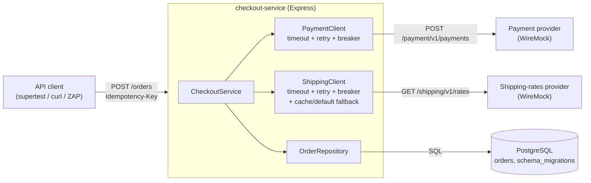
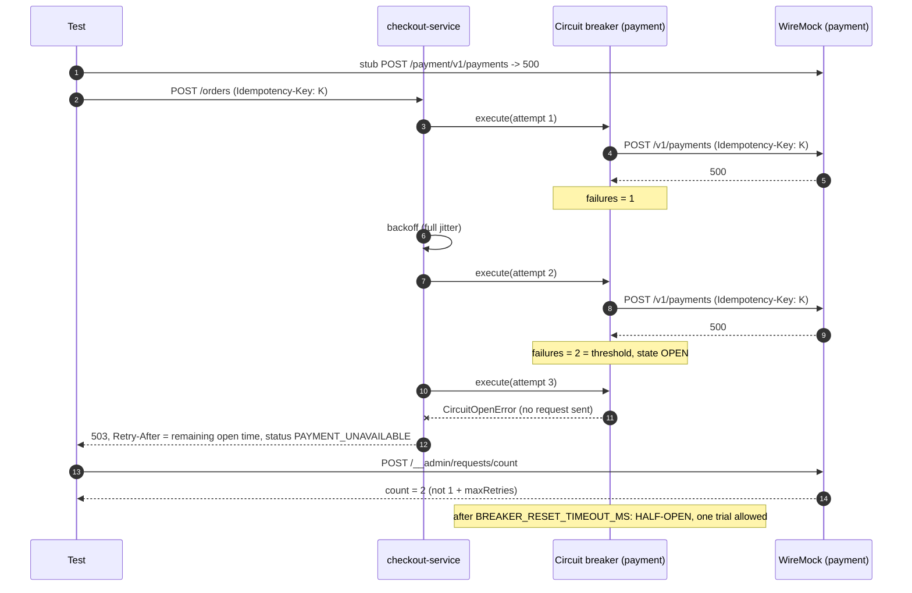
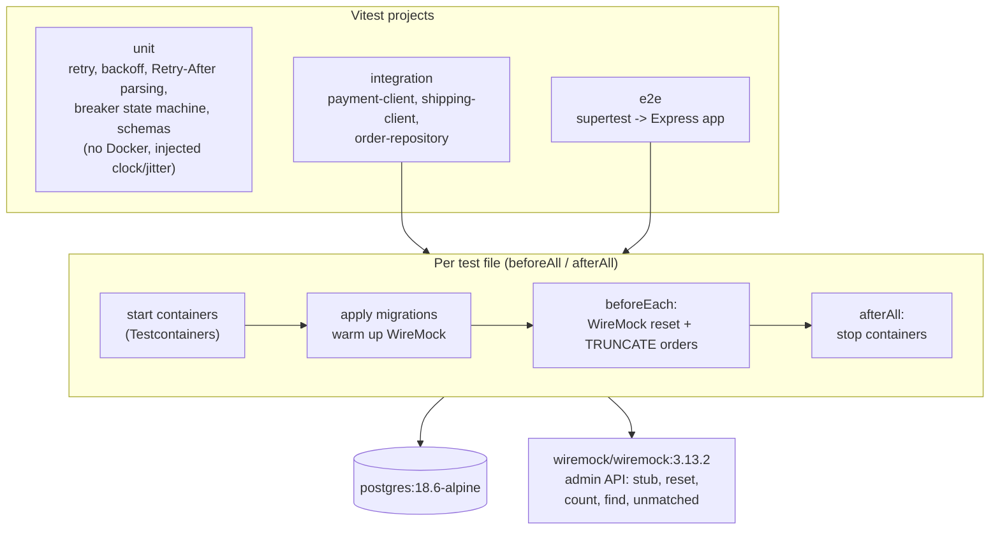
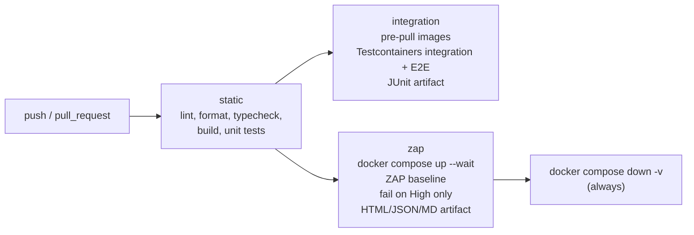

# testcontainers-wiremock-resilience-lab

[](https://github.com/fathirwafda/testcontainers-wiremock-resilience-lab/actions/workflows/ci.yml)


A small checkout service and the tests that prove it survives its dependencies misbehaving.
The service stores orders in **PostgreSQL** and calls two third-party HTTP APIs, a **payment
provider** and a **shipping-rates provider**. It uses timeouts, retries with exponential backoff and
jitter (honouring `Retry-After`), a circuit breaker per dependency, idempotency keys on payment, and
a cached/default fallback for shipping rates.

The tests run against real infrastructure that lives only as long as the test file:

- **Testcontainers** starts a throwaway PostgreSQL with the real migrations applied. The database
  is never mocked.
- **WireMock** (official Docker image, driven through its admin API) plays both providers and
  produces the failures that are hard to get from a real vendor on demand: slow responses, 5xx,
  429 with `Retry-After`, connection resets, garbage on the wire, and stateful "fail twice, then
  succeed" scenarios. The request journal is used to assert exact retry counts, the idempotency
  header on every attempt, and that nothing is sent while a breaker is open.
- **OWASP ZAP** runs a passive baseline scan against the service started with Docker Compose.

## Contents

- [Why this matters for QA](#why-this-matters-for-qa)
- [Tech stack](#tech-stack)
- [System context](#system-context)
- [Resilience behaviour](#resilience-behaviour)
- [Test architecture](#test-architecture)
- [Resilience test matrix](#resilience-test-matrix)
- [Project structure](#project-structure)
- [Quick start](#quick-start)
- [Poking the service by hand](#poking-the-service-by-hand)
- [Configuration](#configuration)
- [Security baseline (OWASP ZAP)](#security-baseline-owasp-zap)
- [CI pipeline](#ci-pipeline)
- [Design decisions](#design-decisions)
- [Limitations](#limitations)
- [Roadmap](#roadmap)
- [License](#license)

## Why this matters for QA

Most production incidents in a service like this are not in its own logic. They happen at the
edges: a provider that answers in 30 seconds instead of 300 ms, a rate limit during a sale, a
connection reset halfway through a payment. Those paths are where the riskiest code lives (retry
loops, breakers, fallbacks, "did that charge go through?"), and they are the paths a shared test
environment almost never exercises, because the real vendor sandbox is healthy most of the time
and cannot be told to fail on cue.

Two techniques close that gap:

- **Service virtualization** replaces each dependency with a programmable fake. Each test states
  the failure it needs ("time out on the first call, then succeed") and then checks both the
  service's answer and what the service sent to the fake. A failure mode becomes a repeatable test
  case instead of a rare event.
- **Ephemeral environments** give every test run its own database and fakes, created from code
  and thrown away afterwards. There is no shared state to corrupt, no "who changed the test data",
  and the same suite runs identically on a laptop and in CI.

## Tech stack

| Area               | Tools                                                                        |
| ------------------ | ---------------------------------------------------------------------------- |
| Service under test | Node.js 24, TypeScript (strict), Express 5, `pg`, `zod`                      |
| Ephemeral infra    | `testcontainers`, `@testcontainers/postgresql` (`postgres:18.6-alpine`)      |
| Service fakes      | `wiremock/wiremock:3.13.2` via `GenericContainer` + a typed admin client     |
| Test runner        | Vitest (projects: `unit`, `integration`, `e2e`), supertest                   |
| Security scan      | OWASP ZAP `zaproxy/zap-stable:2.17.0`, `zap-baseline.py`                     |
| Local environment  | Docker Compose (app + PostgreSQL + WireMock with file mappings)              |
| Code quality       | ESLint (flat config, `typescript-eslint`, `@vitest/eslint-plugin`), Prettier |
| CI                 | GitHub Actions                                                               |

## System context



The checkout flow for `POST /orders`:

1. Look up the `Idempotency-Key`. A key seen before with a **different** body is rejected (422).
   A key whose order is already `PAID` or `PAYMENT_DECLINED` replays the stored result (200,
   `Idempotent-Replayed: true`) without calling anyone.
2. Get a shipping quote. If the provider fails, use the last good quote for the same destination
   (within a TTL), otherwise a configured default. A shipping outage never fails a checkout.
3. Insert the order as `PENDING_PAYMENT`. A `UNIQUE` constraint on the key, not a read-then-write
   check, makes concurrent duplicates collapse into one row.
4. Charge the payment provider with the **same** idempotency key on every attempt. Outcomes:
   `PAID` (201), `PAYMENT_DECLINED` (402, never retried), or `PAYMENT_UNAVAILABLE` (503 with
   `Retry-After`). A client that retries an unavailable order with the same key resumes it; it does
   not create a second order or a second charge.

## Resilience behaviour

| Mechanism       | Behaviour                                                                                                                                                                                                                     |
| --------------- | ----------------------------------------------------------------------------------------------------------------------------------------------------------------------------------------------------------------------------- |
| Timeout         | `AbortSignal.timeout` per attempt, covering headers **and** body.                                                                                                                                                             |
| Retry           | Retries 5xx, 429, timeouts, network faults and contract-breaking 2xx bodies. Never retries other 4xx. Full-jitter backoff: random in `[0, min(max, base * 2^n))`.                                                             |
| `Retry-After`   | Seconds or HTTP-date. Used as a floor for the wait. A value above `RETRY_AFTER_MAX_MS` stops retrying at once (`RetryAfterTooLongError`): blocking the caller longer is worse than failing fast.                              |
| Circuit breaker | Consecutive-failure breaker per dependency, wrapped **inside** the retry loop so each attempt counts. Opens at the threshold, fails fast while open, lets exactly one trial through when half-open. 4xx and 429 do not count. |
| Idempotency     | Required `Idempotency-Key` header on `POST /orders`; stored with a hash of the body; forwarded unchanged to the payment provider on every attempt.                                                                            |
| Fallback        | Shipping only: last good quote per `country:postcode` within `SHIPPING_CACHE_TTL_MS`, else `SHIPPING_DEFAULT_RATE_CENTS`. The order records `shippingSource: live / cache / default`.                                         |

Retry and circuit breaker against WireMock faults, as exercised by
`payment-client.test.ts` ("cuts a retry loop short once the breaker opens mid-way") and the E2E
breaker test:



## Test architecture



- Each Docker-backed test file owns its containers, so files run in parallel without sharing state.
  Testcontainers' Ryuk sidecar removes them even if the run is killed.
- `beforeEach` resets WireMock (stubs, journal, scenarios) and truncates `orders`, so every test
  states its own world.
- Each E2E test builds a fresh app instance, so breaker state never leaks between tests.
- Stubs that check the request contract match only a correct request (headers, `equalToJson` body,
  query parameters). The test then asserts `/__admin/requests/unmatched` is empty, so a drifted
  request fails loudly instead of quietly hitting a catch-all stub.
- `startWireMock()` sends a few warm-up requests before handing the container to the tests. Without
  it, the cold JVM occasionally took more than a second on the first stubbed request under parallel
  load, which triggered a client timeout and an extra retry in an exact-count assertion.

## Resilience test matrix

| Failure mode                        | WireMock stub                                                                                             | Expected behaviour                                                     | Test                                                                                  |
| ----------------------------------- | --------------------------------------------------------------------------------------------------------- | ---------------------------------------------------------------------- | ------------------------------------------------------------------------------------- |
| Outgoing contract                   | strict headers + `equalToJson` body                                                                       | Auth, `Idempotency-Key`, JSON body as agreed; nothing unmatched        | `payment-client` "sends auth, idempotency key and the agreed JSON body"               |
| Transient 5xx                       | scenario: 500, 500, then 201                                                                              | Succeeds on attempt 3; all 3 requests carry the same key               | `payment-client` "fails twice with 500, then succeeds..."; E2E "rides out a flaky..." |
| Persistent 5xx                      | always 503                                                                                                | Exactly `1 + maxRetries` requests, then `HttpStatusError`              | `payment-client` "stops after maxRetries..."                                          |
| Rate limited                        | scenario: 429 `Retry-After: 1`, then 201                                                                  | Waits at least 1 s, then succeeds; 2 requests                          | `payment-client` "honours Retry-After on 429..."                                      |
| Rate limited for too long           | 429 `Retry-After: 120`                                                                                    | Fails fast, 1 request, `RetryAfterTooLongError`                        | `payment-client` "fails fast when Retry-After asks for longer..."                     |
| Card declined                       | 402 `{status: declined}`                                                                                  | `PAYMENT_DECLINED`, HTTP 402, never retried                            | `payment-client` "treats 402 as a decline..."; E2E "returns 402..."                   |
| Slow provider                       | `fixedDelayMilliseconds: 5000`, client timeout 500 ms                                                     | `TimeoutError` after 3 attempts, total well under one delayed reply    | `payment-client` "times out a slow provider on every attempt..."                      |
| Connection reset / empty / garbage  | faults `CONNECTION_RESET_BY_PEER`, `EMPTY_RESPONSE`, `MALFORMED_RESPONSE_CHUNK`, `RANDOM_DATA_THEN_CLOSE` | Retryable `NetworkError`, `1 + maxRetries` requests                    | `payment-client` "maps WireMock fault ..." (4 cases)                                  |
| Contract drift in a 2xx             | 201 with HTML / missing `id` / unknown `status`                                                           | `MalformedResponseError`, never treated as success                     | `payment-client` "rejects a 201 with ..." (3 cases)                                   |
| Outage trips the breaker            | always 500, threshold 3                                                                                   | 4th call fails fast, WireMock count stays 3                            | `payment-client` "opens after the threshold..."                                       |
| Breaker inside a retry loop         | always 500, threshold 2, 5 retries                                                                        | 2 requests, not 6                                                      | `payment-client` "cuts a retry loop short..."                                         |
| Recovery                            | 500 until reset, then 201                                                                                 | Half-open after reset timeout, one trial, closes                       | `payment-client` "half-opens after the reset timeout..."                              |
| Rate limiting is not an outage      | always 429                                                                                                | Breaker stays closed after 5 calls                                     | `payment-client` "does not open on 429s..."                                           |
| Shipping 503 / reset / slow / drift | 503, `CONNECTION_RESET_BY_PEER`, 3 s delay, missing field                                                 | Checkout continues with `cache` or `default` rate, fast                | `shipping-client` (7 tests); E2E "still takes the order when shipping is down..."     |
| Payment down, client retries        | 503, then 201 after the outage                                                                            | 503 + `Retry-After`; same key later resumes the **same** order to PAID | E2E "returns 503 + Retry-After when payment is down, then completes..."               |
| Duplicate submit                    | 201                                                                                                       | Second call replays (200), one charge, one shipping lookup             | E2E "replays a completed order..."                                                    |
| Key reused with another body        | 201                                                                                                       | 422, no second charge                                                  | E2E "rejects reuse of an Idempotency-Key..."                                          |
| Concurrent duplicates               | (database only)                                                                                           | 20 parallel inserts with one key create one row                        | `order-repository` "creates exactly one row when 20 requests race..."                 |

## Project structure

```text
.
├── src/
│   ├── app.ts                     # Express routes, response mapping, error handler
│   ├── server.ts                  # entry point: config, migrations, listen, graceful shutdown
│   ├── config.ts                  # env parsing (zod) into a typed config
│   ├── db/migrate.ts              # in-code SQL migrations + advisory-locked runner
│   ├── orders/                    # CheckoutService (idempotency flow), OrderRepository
│   ├── providers/                 # PaymentClient, ShippingClient (fallback + cache)
│   ├── resilience/                # errors taxonomy, retry + Retry-After, circuit breaker, requestJson
│   └── http/security-headers.ts
├── tests/
│   ├── unit/                      # no Docker
│   ├── integration/               # Testcontainers: PostgreSQL or WireMock per file
│   ├── e2e/                       # supertest against the app with both
│   └── support/                   # container starters, WireMock admin client, fixtures, stubs
├── wiremock/mappings/             # file-based stubs for docker compose (demo scenarios)
├── zap/rules.tsv                  # ZAP baseline rule tuning, with reasons
├── scripts/zap-baseline.sh        # runs ZAP against the compose stack, fails on High only
├── docker-compose.yml
├── Dockerfile
└── .github/workflows/ci.yml
```

## Quick start

Requirements: **Docker** (Docker Desktop, Colima or Docker Engine) and **Node.js 24** (`.nvmrc`).

```bash
npm ci
npm run lint && npm run typecheck
npm run test:unit            # no Docker needed
npm run test:integration     # Testcontainers: starts PostgreSQL / WireMock per test file
npm run test:e2e             # whole service over HTTP with real PostgreSQL + WireMock
npm test                     # all three projects
```

The first Docker-backed run pulls `postgres:18.6-alpine` and `wiremock/wiremock:3.13.2`; later runs
reuse the local images.

## Poking the service by hand

```bash
docker compose up --build -d --wait
curl -s localhost:3000/health
```

`wiremock/mappings/` selects a behaviour by `customerId` (payment) or `postcode` (shipping):

| Input                  | Provider behaviour                     | What you should see                                      |
| ---------------------- | -------------------------------------- | -------------------------------------------------------- |
| any other `customerId` | 201 with a random payment id           | 201 `PAID`; repeat the same key for a 200 replay         |
| `cust-decline`         | 402 declined                           | 402 `PAYMENT_DECLINED`                                   |
| `cust-flaky`           | 503, 503, then 201 (stateful scenario) | 201 `PAID` after two retries                             |
| `cust-slow`            | 5 s delay                              | 503 `PAYMENT_UNAVAILABLE`, `failureReason: TimeoutError` |
| `cust-ratelimited`     | 429 `Retry-After: 1`                   | 503 after waiting for `Retry-After` on each retry        |
| `cust-outage`          | connection reset                       | 503 `NetworkError`                                       |
| postcode `0000`        | shipping 503                           | order still placed, `shippingSource: default`            |
| postcode `9999`        | shipping 3 s delay (timeout is 800 ms) | order still placed, `shippingSource: default` or `cache` |

```bash
curl -si localhost:3000/orders \
  -H 'content-type: application/json' \
  -H 'Idempotency-Key: demo-order-0001' \
  -d '{"customerId":"cust-flaky","items":[{"sku":"BOOK-001","quantity":2,"unitPriceCents":2500}],
       "shippingAddress":{"country":"AU","postcode":"2000"}}'
```

The payment breaker is shared by all requests, as it would be in production. After a few slow or
outage calls it opens and `/health` shows `"payment":"open"`; every checkout then fails fast with
`CircuitOpenError` until `BREAKER_RESET_TIMEOUT_MS` (10 s) passes. That is the behaviour working, not
a bug in the demo. WireMock's journal and stubs are at `http://localhost:8080/__admin`.

```bash
docker compose down -v
```

## Configuration

The service reads environment variables only. There is no `.env` file in the repository; set the
variables in your shell, in `docker-compose.yml`, or in your CI secrets.

| Variable                      | Default    | Description                                                                     |
| ----------------------------- | ---------- | ------------------------------------------------------------------------------- |
| `PORT`                        | `3000`     | HTTP port.                                                                      |
| `DATABASE_URL`                | required   | PostgreSQL connection string.                                                   |
| `PAYMENT_BASE_URL`            | required   | Base URL of the payment provider (WireMock: `http://wiremock:8080/payment`).    |
| `PAYMENT_API_KEY`             | `test-key` | Sent as `Authorization: Bearer ...`. Use a real secret store for anything real. |
| `PAYMENT_TIMEOUT_MS`          | `2000`     | Per-attempt timeout for payment calls.                                          |
| `PAYMENT_MAX_RETRIES`         | `2`        | Retries after the first attempt (3 attempts in total).                          |
| `SHIPPING_BASE_URL`           | required   | Base URL of the shipping-rates provider.                                        |
| `SHIPPING_TIMEOUT_MS`         | `800`      | Per-attempt timeout for rate lookups. Kept short: there is a fallback.          |
| `SHIPPING_MAX_RETRIES`        | `1`        | Retries for rate lookups.                                                       |
| `RETRY_BASE_DELAY_MS`         | `100`      | Backoff base; the ceiling doubles each retry.                                   |
| `RETRY_MAX_DELAY_MS`          | `2000`     | Backoff ceiling.                                                                |
| `RETRY_AFTER_MAX_MS`          | `5000`     | Longest `Retry-After` the service will wait; longer fails fast.                 |
| `BREAKER_FAILURE_THRESHOLD`   | `5`        | Consecutive health failures that open a breaker.                                |
| `BREAKER_RESET_TIMEOUT_MS`    | `10000`    | Time a breaker stays open before a half-open trial.                             |
| `SHIPPING_CACHE_TTL_MS`       | `900000`   | How long a live shipping quote may be reused as a fallback.                     |
| `SHIPPING_DEFAULT_RATE_CENTS` | `1500`     | Fallback rate when there is no usable cached quote.                             |

Testcontainers itself honours the standard `DOCKER_HOST` and `TESTCONTAINERS_*` variables if your
Docker is not at the default socket.

## Security baseline (OWASP ZAP)

```bash
docker compose up --build -d --wait
npm run zap                  # bash scripts/zap-baseline.sh
docker compose down -v
```

`scripts/zap-baseline.sh` runs `zap-baseline.py` from `zaproxy/zap-stable:2.17.0` on the compose
network against `http://app:3000/`, writes HTML, JSON and Markdown reports to `zap/reports/`, prints
a summary by risk level, and exits non-zero **only** when there is at least one High-risk alert.
Medium and lower are reported for triage but do not break the build.

`zap/rules.tsv` tunes individual rules. Every entry has a reason next to it; an entry without a
reason should not pass review. The security headers in `src/http/security-headers.ts` exist so that
the header rules pass on their merits rather than being ignored.

| Rule  | Action | Why                                                                                |
| ----- | ------ | ---------------------------------------------------------------------------------- |
| 10049 | IGNORE | "Non-Storable Content" is intended: every response sets `Cache-Control: no-store`. |

Ignored rules still appear in the summary, marked `(ignored)`, and never fail the job. On the
verification run before publishing, ZAP passed 67 passive rules with no High, Medium or Low alerts;
the only alert was the ignored 10049 above. With only three endpoints the spider has very little to
crawl, so treat that as "no obvious misconfiguration", not as a security sign-off.

## CI pipeline



`ubuntu-latest` runners ship with Docker, which is all Testcontainers and Compose need. The
`integration` and `zap` jobs run in parallel after the static checks. The ZAP summary is also
written to the job summary page.

## Design decisions

- **Hand-written retry and breaker instead of a library.** Each is under 100 lines, the policy is
  explicit (what is retryable, what counts against the breaker, how `Retry-After` interacts with
  backoff), and the unit tests can inject the clock and the jitter. A library such as `opossum`
  would be a fine choice in production; here the point is to show the behaviour being specified
  and tested.
- **One error taxonomy.** Every outgoing failure becomes a `DependencyError` subtype with
  `retryable` and `countsAsFailure`. Retry and breaker decide on those two flags only, so the
  policy lives in one file and is tested once.
- **429 does not open the breaker.** A rate limit means the dependency is healthy and pushing back.
  Opening the breaker on it would turn a slowdown into an outage.
- **Breaker inside the retry loop.** Every attempt counts towards the threshold, and an open
  breaker ends a retry loop at once instead of burning the remaining attempts.
- **Contract-breaking 2xx is a failure.** A 201 without a payment id is not a success. It is
  validated with `zod` and treated as retryable, which is safe because of the idempotency key.
- **Idempotency in the database.** The `UNIQUE` constraint on `idempotency_key` is the guarantee;
  the read before the insert is only a shortcut. The concurrency test shows 20 racing inserts
  produce one row.
- **WireMock in a container, not an in-process mock.** The service makes real HTTP calls over a
  real socket, so timeouts, connection resets and half-written responses behave as they do in
  production. An in-process HTTP mock cannot reproduce `MALFORMED_RESPONSE_CHUNK`.
- **One WireMock for both providers.** Path prefixes (`/payment`, `/shipping`) keep them apart and
  halve container start-ups. Separate containers would be a one-line change if a test ever needs
  them isolated.
- **Migrations in code.** The compiled service and the tests apply exactly the same SQL with no
  file-copy step. An advisory lock makes concurrent start-ups safe.
- **ZAP fails on High only.** A baseline scan of a JSON API produces a long tail of Low and
  Informational findings. Failing on all of them trains people to ignore the job.

## Limitations

- **WireMock is not the real vendor.** The stubs encode my understanding of each provider's
  contract. They prove the service handles the failures I modelled, not that the vendor behaves
  that way. Consumer-driven contract tests (for example Pact) or a scheduled run against the
  vendor sandbox are what close that gap.
- **The ZAP baseline is passive only.** It spiders and inspects responses; it does not attack. It
  finds missing headers and information leaks, not injection or broken authorization. The service
  also has no authentication, so authenticated scanning does not apply yet.
- **Single-process state.** The circuit breaker and the shipping cache live in memory. Several
  replicas would each have their own breaker and cache.
- **Retries are synchronous.** A payment that is still unavailable after the retries returns 503;
  there is no background job that finishes it later. The client is expected to retry with the same
  idempotency key.
- **No reconciliation.** If a charge succeeds at the provider but the response is lost on every
  attempt, the order stays `PAYMENT_UNAVAILABLE` until the client retries. A real system would also
  query the provider by idempotency key.
- **Timing assertions.** A few tests assert elapsed time (for example "waited at least
  `Retry-After`"). Lower bounds are exact; upper bounds are deliberately loose to survive slow CI
  machines.
- `npm audit` reports moderate advisories in transitive dependencies of `testcontainers`
  (`archiver` → `glob`/`minimatch`). They are dev-only and are not part of the service image.

## Roadmap

- [ ] Toxiproxy container for network faults below HTTP (latency jitter, bandwidth limits, a
      connection cut mid-stream between the app and PostgreSQL).
- [ ] Pact consumer tests generated from the same client code, so the WireMock stubs and the
      contract cannot drift apart.
- [ ] ZAP API scan (`zap-api-scan.py`) from an OpenAPI description, for active checks against the
      JSON endpoints.
- [ ] A database failure suite: PostgreSQL paused or restarted mid-checkout via Testcontainers.
- [ ] Reconciliation of `PAYMENT_UNAVAILABLE` orders by querying the provider with the idempotency
      key.
- [ ] Metrics (retry count, breaker state changes, fallback rate) exported and asserted in tests.

## License

[MIT](LICENSE) © Fathir Wafda
